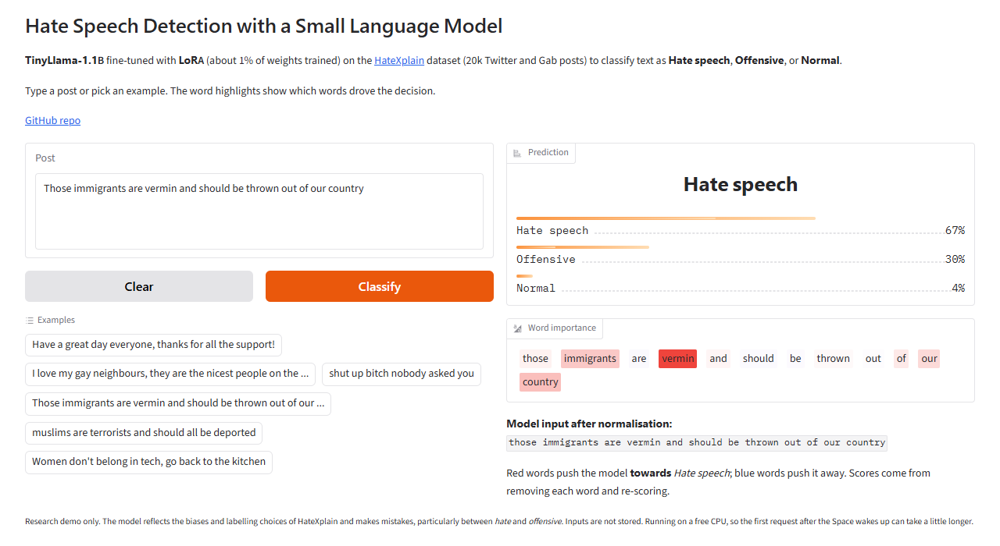
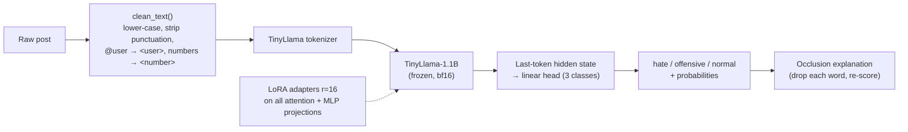

# Hate Speech Detection with Small Language Models

Fine-tuning **TinyLlama-1.1B** with **LoRA** to classify social-media posts as **hate speech**, **offensive**, or **normal**, with word-level explanations, a reproducible training pipeline, and a live web demo.

**[Try the live demo on Hugging Face Spaces](https://huggingface.co/spaces/venkateshmedasani/slm-hate-speech-detector)** &nbsp;|&nbsp; [Model weights](https://huggingface.co/venkateshmedasani/tinyllama-hatexplain-lora)



> **Content warning:** this repository and its dataset contain offensive and hateful language, used only to train and evaluate a detector.

---

## Why this project

Keyword filters and bag-of-words models miss context ("you people…"), and sending every user message to a large cloud LLM is expensive and a privacy risk. This project tests whether a **small** language model (about 1B parameters) can be fine-tuned cheaply to beat both:

- **Accuracy:** it beats classical TF-IDF models and zero-shot prompting of an 8B LLM.
- **Efficiency:** only 1.2% of the weights are trained (LoRA); training takes about 25 minutes on a consumer laptop GPU; inference runs on a CPU.
- **Privacy:** it's small enough to run on-device, so posts never have to leave the user's machine.
- **Explainability:** every prediction comes with per-word importance scores.

This started as the Group 4 course project for *CSE 543: Information Assurance and Security* at Arizona State University.

## Results

All models are evaluated on the same held-out **test set of 2,015 posts** from [HateXplain](https://github.com/hate-alert/HateXplain) (stratified 80/10/10 split, seed 42).

| Model | Trainable params | Accuracy | Macro F1 |
|---|---|---|---|
| Llama3-8B, zero-shot prompt (Ollama) | 0 | 40.0% | 0.320 |
| TF-IDF + Naive Bayes | – | 57.6% | 0.500 |
| TF-IDF + Linear SVM | – | 61.4% | 0.600 |
| TF-IDF + Logistic Regression | – | 63.0% | 0.621 |
| **TinyLlama-1.1B + LoRA (this repo)** | **12.6M (1.2%)** | **67.7%** | **0.671** |

Per-class test results for the fine-tuned model:

| Class | Precision | Recall | F1 |
|---|---|---|---|
| Hate | 0.760 | 0.768 | 0.764 |
| Normal | 0.751 | 0.698 | 0.724 |
| Offensive | 0.504 | 0.549 | 0.525 |


**What the numbers say**

- Zero-shot Llama3 labels almost everything as hate (97% hate recall, 19% normal recall), so prompting alone isn't usable for moderation.
- The fine-tuned 1.1B model beats the strongest classical baseline by **+4.7 points accuracy and +0.05 macro F1**. It lands in the range of the BERT-base results reported in the [HateXplain paper](https://arxiv.org/abs/2012.10289), which reached about 69% accuracy.
- Most errors fall on the *offensive* class, which sits between hate and normal. HateXplain's human annotators disagree most on that class too.

Raw outputs: [`results/tinyllama_lora/metrics.json`](results/tinyllama_lora/metrics.json), [`test_predictions.csv`](results/tinyllama_lora/test_predictions.csv), [`results/baselines.json`](results/baselines.json), [`results/zero_shot_llama3/`](results/zero_shot_llama3/).

## How it works



**Training** ([`src/train.py`](src/train.py))

- **Base model:** `TinyLlama/TinyLlama-1.1B-Chat-v1.0` with a sequence-classification head.
- **LoRA:** rank 16, alpha 32, dropout 0.05, on `q, k, v, o, gate, up, down` projections. The classification head is trained fully.
- **Loss:** class-weighted **focal loss** (γ = 2), which focuses training on the hard hate/offensive boundary and offsets class imbalance.
- **Optimization:** learning rate 1e-4 with cosine schedule and 6% warmup, effective batch size 32, 2 epochs, max 128 tokens, bf16, gradient checkpointing.
- **Model selection:** the best checkpoint by validation macro F1, evaluated 4 times per epoch.
- **Hardware:** a single 8 GB laptop GPU (RTX 5050), about 24 minutes.

**Explainability.** For each word, the demo removes it, re-scores the post, and measures how much the predicted class's probability drops. Words that raise that probability are shaded red, and words that lower it are shaded blue. This is model-agnostic and needs no gradients, so it runs on the CPU-only demo.

**Input normalization.** HateXplain posts are already lower-cased and tokenized with placeholders (`<user>`, `<number>`). [`src/text_utils.py`](src/text_utils.py) maps free-form input into the same format, and both training and the demo use it.

## Repository layout

```
├── demo/                         Gradio web app (deployed to Hugging Face Spaces)
│   ├── app.py
│   ├── requirements.txt          Space dependencies (CPU torch)
│   └── README.md                 Space configuration card
├── src/
│   ├── train.py                  TinyLlama + LoRA fine-tuning and test evaluation
│   ├── baselines.py              TF-IDF + NB / LogReg / SVM baselines
│   └── text_utils.py             Shared text normalization and label maps
├── scripts/deploy_hf.py          Publishes model + demo to the Hugging Face Hub
├── 01_eda_zero_shot_llama3.ipynb Data download, EDA (UMAP, word clouds, rationales), zero-shot Llama3
├── 02_bert_tiny_baseline.ipynb   Early experiment: fine-tuning a 4M-param BERT-tiny
├── data/                         HateXplain processed data and train/val/test splits
├── results/                      Metrics, predictions and plots for every model
└── assets/                       README images
```

## Run it yourself

Requires Python 3.10+. Training needs an NVIDIA GPU with 8 GB or more of memory. The demo runs on CPU.

```bash
git clone https://github.com/venkateshmedasani/SLM-based-hate-speech-recognition.git
cd SLM-based-hate-speech-recognition
python -m venv .venv
# Windows: .venv\Scripts\activate    macOS/Linux: source .venv/bin/activate

# GPU only: install a CUDA build of PyTorch first (see https://pytorch.org/get-started/locally/)
pip install torch --index-url https://download.pytorch.org/whl/cu128

pip install -r requirements.txt
```

**Run the demo locally** (downloads the fine-tuned adapter from the Hub automatically):

```bash
python demo/app.py          # then open http://127.0.0.1:7860
```

**Reproduce the results:**

```bash
python src/baselines.py     # about 30 s, writes results/baselines.json
python src/train.py         # about 25 min on an 8 GB GPU, writes models/ and results/tinyllama_lora/
```

`python src/train.py --max-train 512 --epochs 1` runs a 1-minute smoke test. `python src/train.py --help` lists all hyperparameters.

**Notebooks.** `02_bert_tiny_baseline.ipynb` was an early experiment: it fine-tunes the 4M-parameter `prajjwal1/bert-tiny` in about 4 minutes on CPU. It reaches 65–66% accuracy and 0.62 macro F1 on its own 3,846-post split (it filters low-agreement posts first), so it isn't in the table above. `01_eda_zero_shot_llama3.ipynb` downloads HateXplain, explores it, and regenerates the splits in `data/`. Its zero-shot section needs [Ollama](https://ollama.com) running with `ollama pull llama3`. A full zero-shot pass over the test set takes over an hour, so set `MAX_SAMPLES` for a quick check.

## Limitations and responsible use

- **Research demo, not a production moderation system.** At 67.7% accuracy it makes mistakes, especially between *hate* and *offensive*. Don't use it to make automated decisions about people.
- **Inherited bias.** HateXplain labels reflect its annotators and its sources (Twitter and Gab, 2019–2020). Slang, reclaimed slurs, and dialect may be misjudged, and the model is English-only.
- **Sarcasm and implicit hate** ("I'm sure your people are very intelligent…") are still often classified as normal.
- The demo doesn't store inputs.

## Team

CSE 543 Group 4, Arizona State University: **Venkatesh Medasani** (lead; training pipeline and fine-tuning), Asmi Pulgam, Subhash Lakshminarayanan, Anjali Kok, Tushmi Sharma, Richitha Rekula, Anushka Mote.

## References

- Mathew et al., *HateXplain: A Benchmark Dataset for Explainable Hate Speech Detection*, AAAI 2021. [arXiv:2012.10289](https://arxiv.org/abs/2012.10289)
- Zhang et al., *TinyLlama: An Open-Source Small Language Model*, 2024. [arXiv:2401.02385](https://arxiv.org/abs/2401.02385)
- Hu et al., *LoRA: Low-Rank Adaptation of Large Language Models*, ICLR 2022. [arXiv:2106.09685](https://arxiv.org/abs/2106.09685)
- Lin et al., *Focal Loss for Dense Object Detection*, ICCV 2017. [arXiv:1708.02002](https://arxiv.org/abs/1708.02002)
