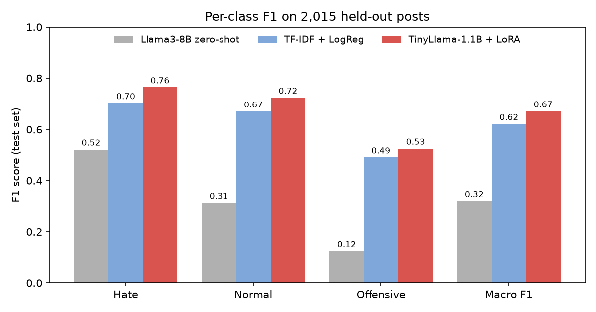
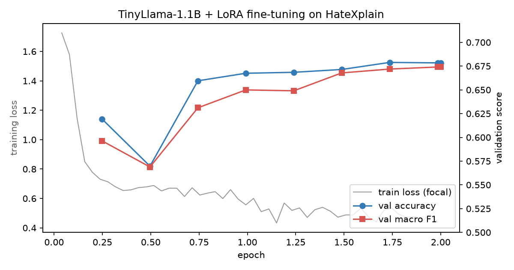
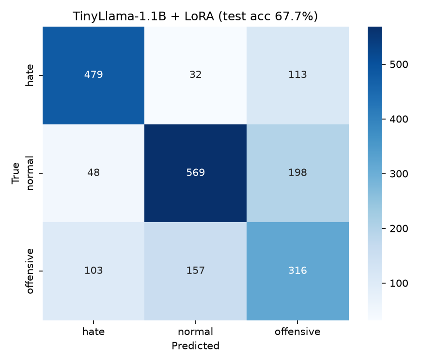
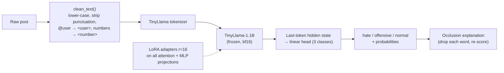

# Hate Speech Detection with Small Language Models

Fine-tuning **TinyLlama-1.1B** with **LoRA** to classify social-media posts as **hate speech**, **offensive**, or **normal**. The project includes word-level explanations, a reproducible training pipeline, and an interactive Gradio demo.

[](assets/demo.mp4)

*Demo walkthrough (click for the MP4). Run it yourself with `python demo/app.py`; see [Run it yourself](#run-it-yourself).*
&nbsp;|&nbsp; [Model weights on Hugging Face](https://huggingface.co/venkateshmedasani/tinyllama-hatexplain-lora)

> **Content warning:** this repository and its dataset contain offensive and hateful language, used only to train and evaluate a detector.

---

## Highlights

- **67.7% accuracy and 0.671 macro F1** on 2,015 held-out HateXplain posts. That beats a TF-IDF + Logistic Regression baseline (63.0%) and zero-shot Llama3-8B (40.0%).
- **80.8% accuracy on posts where all three human annotators agreed.**
- **Only 1.2% of weights trained** (LoRA rank 16): a 50 MB adapter, trained in **24 minutes** on a single 8 GB laptop GPU.
- **Fast inference:** 65 ms per post on GPU, about 0.7 s on a laptop CPU. Small enough to run on-device, so posts never have to leave the user's machine.
- **Explainable:** every prediction comes with per-word importance scores (occlusion).

Keyword filters miss context ("you people…"), and sending every message to a large cloud LLM is costly and a privacy risk. This project shows that a small model fine-tuned cheaply does better than both. It started as a course project for *CSE 543: Information Assurance and Security* at Arizona State University.

## Results

All models are evaluated on the same held-out **test set of 2,015 posts** from [HateXplain](https://github.com/hate-alert/HateXplain) (stratified 80/10/10 split, seed 42).

### Overall

| Model | Trainable params | Accuracy | Macro F1 |
|---|---|---|---|
| Llama3-8B, zero-shot prompt (Ollama) | 0 | 40.0% | 0.320 |
| TF-IDF + Naive Bayes | – | 57.6% | 0.500 |
| TF-IDF + Linear SVM | – | 61.4% | 0.600 |
| TF-IDF + Logistic Regression | – | 63.0% | 0.621 |
| **TinyLlama-1.1B + LoRA (this repo)** | **12.6M (1.2%)** | **67.7%** | **0.671** |

### Per class



| Class | Model | Precision | Recall | F1 |
|---|---|---|---|---|
| Hate | Llama3-8B zero-shot | 0.357 | **0.968** | 0.522 |
| | TF-IDF + LogReg | 0.698 | 0.707 | 0.702 |
| | **TinyLlama + LoRA** | **0.760** | 0.768 | **0.764** |
| Normal | Llama3-8B zero-shot | **0.814** | 0.194 | 0.313 |
| | TF-IDF + LogReg | 0.660 | 0.680 | 0.670 |
| | **TinyLlama + LoRA** | 0.751 | **0.698** | **0.724** |
| Offensive | Llama3-8B zero-shot | 0.339 | 0.076 | 0.125 |
| | TF-IDF + LogReg | **0.506** | 0.477 | 0.491 |
| | **TinyLlama + LoRA** | 0.504 | **0.549** | **0.525** |

Zero-shot Llama3 flags almost everything as hate. That gives it 97% hate recall, but it gets only 19% of normal posts right, so it can't be used for moderation as-is.

### Training curve and confusion matrix

<p>


</p>

Validation macro F1 rises steadily over 2 epochs (evaluated 4 times per epoch), and the best checkpoint by validation macro F1 is kept.

## Error analysis

**Accuracy by annotator agreement.** Each HateXplain post was labeled by three annotators. The model is most accurate exactly where humans agree, and its errors concentrate on posts that people themselves dispute:

| Annotator agreement | Posts | Llama3 zero-shot | TF-IDF + LogReg | TinyLlama + LoRA |
|---|---|---|---|---|
| 3 of 3 agree | 997 | 42.4% | 76.8% | **80.8%** |
| 2 of 3 agree | 930 | 37.7% | 52.0% | **57.1%** |
| No majority | 88 | **36.4%** | 22.7% | 30.7% |

**Accuracy by targeted group** (posts annotated as targeting each of the six most frequent groups):

| Target group | Posts | Llama3 zero-shot | TF-IDF + LogReg | TinyLlama + LoRA |
|---|---|---|---|---|
| African | 449 | 59.5% | 63.9% | **68.8%** |
| Women | 394 | 32.0% | 58.9% | **66.0%** |
| Islam | 333 | 56.2% | 52.3% | **63.1%** |
| Jewish | 255 | 61.6% | 63.9% | **66.3%** |
| Homosexual | 246 | 39.4% | 51.6% | **54.5%** |
| Refugee | 183 | 41.5% | 55.2% | **66.1%** |

The fine-tuned model is the most accurate model for every group. The weakest group is posts targeting homosexual people, where reclaimed and in-group language is common.

**Where the errors are** (TinyLlama + LoRA, 651 misclassified test posts):

| True → predicted | Count | Share of errors |
|---|---|---|
| normal → offensive | 198 | 30.4% |
| offensive → normal | 157 | 24.1% |
| hate → offensive | 113 | 17.4% |
| offensive → hate | 103 | 15.8% |
| normal → hate | 48 | 7.4% |
| hate → normal | 32 | 4.9% |

88% of errors involve the *offensive* class, the fuzzy middle ground between hate and normal. Hate and normal are confused with each other only 80 times, 12% of the errors.

## Efficiency

| | |
|---|---|
| Total parameters | 1.1B (TinyLlama-1.1B-Chat-v1.0) |
| Trainable parameters | 12.6M (1.2%): LoRA adapters + classification head |
| Adapter size on disk | 50 MB |
| Training time | 24 min, 2 epochs, RTX 5050 Laptop GPU (8 GB) |
| GPU memory at inference (bf16) | 2.1 GB |
| Latency per post, GPU | 65 ms (180 ms with word explanations) |
| Latency per post, CPU (Ryzen 7 250, fp32) | 0.71 s (2.2 s with word explanations) |

For comparison, the zero-shot Llama3-8B run needed about 2.5 s per post through Ollama on a 4 GB GPU, and was far less accurate.

## Dataset

[HateXplain](https://github.com/hate-alert/HateXplain) has 20,148 posts from Twitter and Gab, each labeled by three annotators. The label is the majority vote.

| Split | Posts | Hate | Normal | Offensive | Avg. words |
|---|---|---|---|---|---|
| Train | 16,118 | 4,987 | 6,522 | 4,609 | 23.6 |
| Validation | 2,015 | 623 | 816 | 576 | 23.5 |
| Test | 2,015 | 624 | 815 | 576 | 23.8 |

## How it works



**Training** ([`src/train.py`](src/train.py))

- **Base model:** `TinyLlama/TinyLlama-1.1B-Chat-v1.0` with a sequence-classification head.
- **LoRA:** rank 16, alpha 32, dropout 0.05, on the `q, k, v, o, gate, up, down` projections. The classification head is trained fully.
- **Loss:** class-weighted **focal loss** (γ = 2). It focuses training on the hard hate/offensive boundary and offsets class imbalance.
- **Optimization:** learning rate 1e-4 with cosine schedule and 6% warmup, effective batch size 32, 2 epochs, max 128 tokens, bf16, gradient checkpointing.
- **Model selection:** the best checkpoint by validation macro F1.

**Explainability.** For each word, the demo removes it, re-scores the post, and measures how much the predicted class's probability drops. Words that raise the probability are shaded red, and words that lower it are shaded blue. The method needs no gradients and works with any model.

**Input normalization.** HateXplain posts are already lower-cased and tokenized with placeholders (`<user>`, `<number>`). [`src/text_utils.py`](src/text_utils.py) maps free-form input into the same format, and both training and the demo use it.

## Repository layout

```
├── demo/app.py                   Gradio web app (prediction + word-importance explanation)
├── src/
│   ├── train.py                  TinyLlama + LoRA fine-tuning and test evaluation
│   ├── baselines.py              TF-IDF + NB / LogReg / SVM baselines
│   └── text_utils.py             Shared text normalization and label maps
├── scripts/
│   ├── analyze_results.py        Builds the comparison tables and figures in this README
│   └── deploy_hf.py              Publishes the trained adapter to the Hugging Face Hub
├── 01_eda_zero_shot_llama3.ipynb Data download, EDA (UMAP, word clouds, rationales), zero-shot Llama3
├── 02_bert_tiny_baseline.ipynb   Early experiment: fine-tuning a 4M-param BERT-tiny
├── data/                         HateXplain processed data and train/val/test splits
├── results/                      Metrics, predictions and training logs for every model
└── assets/                       README images and demo video
```

## Run it yourself

Requires Python 3.10+. Training needs an NVIDIA GPU with 8 GB or more of memory. The demo runs on CPU.

```bash
git clone https://github.com/venkateshmedasani/SLM-based-hate-speech-recognition.git
cd SLM-based-hate-speech-recognition
python -m venv .venv
# Windows: .venv\Scripts\activate    macOS/Linux: source .venv/bin/activate

# GPU only: install a CUDA build of PyTorch first (see https://pytorch.org/get-started/locally/)
pip install torch --index-url https://download.pytorch.org/whl/cu128

pip install -r requirements.txt
```

**Run the demo** (downloads the fine-tuned adapter from the Hugging Face Hub automatically):

```bash
python demo/app.py          # then open http://127.0.0.1:7860
```

**Reproduce the results:**

```bash
python src/baselines.py             # about 30 s
python src/train.py                 # about 25 min on an 8 GB GPU
python scripts/analyze_results.py   # tables + figures
```

`python src/train.py --max-train 512 --epochs 1` runs a 1-minute smoke test. `python src/train.py --help` lists all hyperparameters.

**Notebooks.**

- `01_eda_zero_shot_llama3.ipynb` downloads HateXplain, explores it, and regenerates the splits in `data/`. Its zero-shot section needs [Ollama](https://ollama.com) running with `ollama pull llama3`. A full zero-shot pass over the test set takes over an hour, so set `MAX_SAMPLES` for a quick check.
- `02_bert_tiny_baseline.ipynb` was an early experiment that fine-tunes the 4M-parameter `prajjwal1/bert-tiny` in about 4 minutes on CPU. It reaches 65–66% accuracy and 0.62 macro F1 on its own 3,846-post split, so it isn't in the tables above.

## Limitations and responsible use

- **Research demo, not a production moderation system.** At 67.7% accuracy it makes mistakes, especially around the *offensive* class. Don't use it to make automated decisions about people.
- **Inherited bias.** HateXplain labels reflect its annotators and its sources (Twitter and Gab, 2019–2020). Slang, reclaimed slurs, and dialect may be misjudged, and the model is English-only.
- **Sarcasm and implicit hate** ("I'm sure your people are very intelligent…") are still often classified as normal.

## References

- Mathew et al., *HateXplain: A Benchmark Dataset for Explainable Hate Speech Detection*, AAAI 2021. [arXiv:2012.10289](https://arxiv.org/abs/2012.10289)
- Zhang et al., *TinyLlama: An Open-Source Small Language Model*, 2024. [arXiv:2401.02385](https://arxiv.org/abs/2401.02385)
- Hu et al., *LoRA: Low-Rank Adaptation of Large Language Models*, ICLR 2022. [arXiv:2106.09685](https://arxiv.org/abs/2106.09685)
- Lin et al., *Focal Loss for Dense Object Detection*, ICCV 2017. [arXiv:1708.02002](https://arxiv.org/abs/1708.02002)
